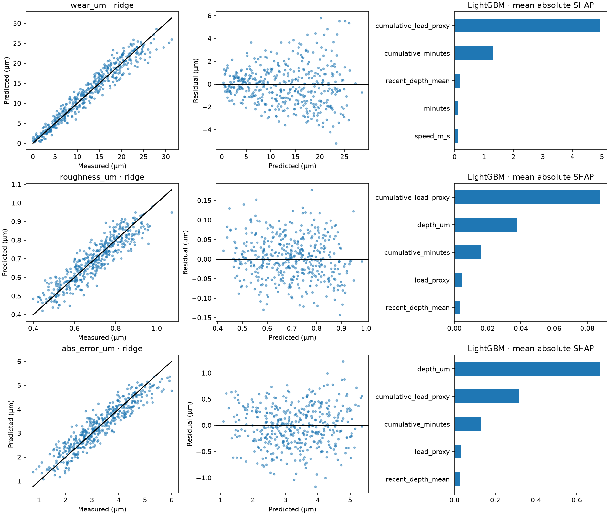

# ToolWear Analytics · Predictive Modelling of Grinding Wheel Wear and Tool Quality

ToolWear Analytics benchmarks regressors for cumulative wheel wear, surface roughness, and absolute dimensional deviation. The evaluation asks how well each model transfers to a wheel excluded from training.

## Run with Python 3.11

```sh
python -m pip install -r requirements.txt
python analyze.py --out results
python analyze.py --input measured.csv --out measured-results
```

## Modelling and validation

The synthetic benchmark simulates 60 wheels with 30 ordered runs per wheel. Inputs include each run’s speed, feed, depth, and duration. Features include a feed–depth load proxy, its time-weighted cumulative sum, cumulative runtime, and the rolling mean depth of the five most recent runs including the current one. Predictions assume current-run inputs are known and the wheel history is complete through that run.

The workflow reserves 25% of wheels for evaluation. Within the remaining wheels, four-fold grouped MAE selects a median baseline, scaled Ridge model, or LightGBM for each response. The scorecard reports holdout MAE, RMSE, and R² for all candidates. Splitting by wheel prevents runs from a given wheel from appearing on both sides. TreeSHAP summarizes LightGBM feature contributions on the held-out rows, including when a different model wins. Correlated history features can share attribution, and SHAP values describe model behavior.

## Input and outputs

Ridge had the lowest grouped cross-validation MAE for all three targets. Its [holdout scores](results/metrics.csv) cover 450 runs from 15 simulated wheels.

| Response | MAE (µm) | RMSE (µm) | R² |
| --- | ---: | ---: | ---: |
| Wheel wear | 1.365 | 1.745 | 0.942 |
| Roughness | 0.043 | 0.054 | 0.825 |
| Absolute dimensional deviation | 0.313 | 0.385 | 0.866 |

The simulation uses a cumulative load term, which the Ridge feature set captures directly. Holdout errors reflect the simulated wheel-to-wheel variability and measurement noise.



[View held-out wear trajectories](results/wear_trends.png).

### CSV schema and generated files

CSV headers are `wheel_id,run,speed_m_s,feed_mm_s,depth_um,minutes,wear_um,roughness_um,abs_error_um`. Supply at least ten wheels with unique run numbers within each wheel. Include every run since the start of the wheel history. Each output measurement is in micrometres.

- `metrics.csv` contains cross-validation and holdout scores, with the selected model flagged per response.
- `predictions.csv` contains selected-model predictions and measured values for each held-out run.
- `dashboard.png` compares measured values, predictions, residuals, and SHAP importance.
- `wear_trends.png` plots predicted and observed wear trajectories for up to five held-out wheels.
- `shap_*.csv` contains the full mean absolute SHAP importance for each response.

**Data provenance.** The demonstration uses seeded simulation. Assess accuracy on measured wheels from the intended production population before relying on predictions.

**Stack.** Python, pandas, NumPy, SciPy, scikit-learn, LightGBM, SHAP, Matplotlib.
