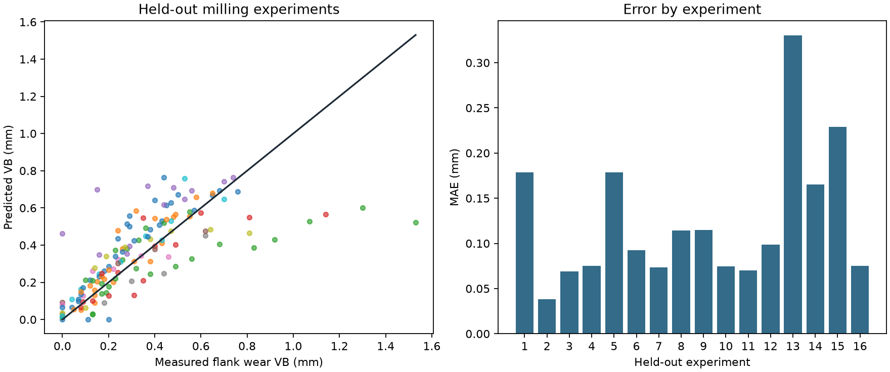

# ToolWear Analytics · Predictive Modelling of Grinding Wheel Wear and Tool Quality

ToolWear Analytics benchmarks regressors for cumulative wheel wear, surface roughness, and absolute dimensional deviation. The evaluation asks how well each model transfers to a wheel excluded from training.

## Measured wear and grinding-quality benchmarks

### Insert wear from six sensor channels

The primary wear benchmark uses [NASA Open Data Milling Wear](https://data.nasa.gov/dataset/milling-wear), provided by UC Berkeley's BEST Lab. It includes **146 records with measured flank wear (VB) across 16 milling experiments**. The measured target is milling-insert wear. Grinding-wheel wear accuracy remains unvalidated.

```sh
python -m pip install -r requirements.txt
curl -L "https://data.nasa.gov/docs/legacy/mill.zip" -o mill.zip
python study.py --input mill.zip --out measured-results
```

Archive SHA-256 is `de9c8685cb0e07b4f39459dc282b49192a3ad660e9577ff99b68dc9994e35d27`. The program reads the original archive locally. The repository contains generated benchmark output.

The feature extractor uses the center half of each recorded trace. It summarizes AC/DC spindle current, table/spindle vibration, and table/spindle acoustic emission using median, interdecile spread, RMS, kurtosis, and an upper-band spectral energy fraction. Missing labels are excluded, and each record uses only its own sensor window. Process baselines and sensor-only/fused ablations test whether sensor features add value. Model and hyperparameter selection happens inside each outer leave-one-experiment-out fold.

| Model | Pooled MAE (mm) | Pooled R² | Case-average MAE (mm) |
| --- | ---: | ---: | ---: |
| Median | 0.1950 | −0.061 | 0.1989 |
| Process Ridge | 0.1410 | 0.411 | 0.1483 |
| Sensor Ridge | 0.1386 | −0.217 | 0.1432 |
| Fused Ridge | 0.1268 | 0.105 | 0.1230 |
| Fused LightGBM | 0.1213 | 0.495 | 0.1206 |
| Inner-CV-selected model | 0.1232 | 0.476 | 0.1237 |

The inner-selected pipeline reduced pooled MAE by **36.8%** against the median. Its case-average MAE has a descriptive case-bootstrap interval of **0.091–0.162 mm**. Resampling held-out case errors describes variability across this benchmark and does not account for all training uncertainty. The fused LightGBM row is a prespecified comparator. [Metrics](measured-results/metrics.csv) · [Predictions](measured-results/predictions.csv) · [Case errors](measured-results/case_mae.csv)



### Does machine current improve grinding-quality prediction?

[Denkena, Wichmann and Wulf (2024), Mendeley Data v3](https://doi.org/10.17632/btngtsstd3.3), CC BY 4.0, gives an independent way to test current-based models on actual grinding. Nested grouped Ridge compares setup inputs against setup plus ten per-flute current/controller summaries. Folds hold out whole settings. The roughness analysis uses 96 runs; diameter error uses all 160.

```sh
curl -L "https://data.mendeley.com/public-files/datasets/btngtsstd3/files/244e6ff4-9351-4484-8cd6-ec84fdb164a2/file_downloaded" -o source.xlsx
python grinding_quality.py --input source.xlsx --out measured-results
```

| Target | Setup-only MAE (µm) | Setup + currents MAE (µm) |
| --- | ---: | ---: |
| Mean roughness | 0.0475 | 0.0519 |
| Mean absolute core-diameter error | 113.39 | 140.23 |

Current summaries increased error for both targets under the observed setting split. This comparison applies to the recorded summary channels and the fitted linear models. [Quality metrics](measured-results/quality_metrics.csv) · [Fold predictions](measured-results/quality_predictions.csv)

## Synthetic grinding-wheel demonstration

The original synthetic wheel pipeline remains available through `analyze.py`.

### Run with Python 3.11

```sh
python -m pip install -r requirements.txt
python analyze.py --out results
python analyze.py --input measured.csv --out measured-results
```

## Modelling and validation

The synthetic benchmark simulates 60 wheels with 30 ordered runs per wheel. Inputs include each run’s speed, feed, depth, and duration. Features include a feed–depth load proxy, its time-weighted cumulative sum, cumulative runtime, and the rolling mean depth of the five most recent runs including the current one. Predictions assume current-run inputs are known and the wheel history is complete through that run.

The workflow reserves 25% of wheels for evaluation. Within the remaining wheels, four-fold grouped MAE selects a median baseline, scaled Ridge model, or LightGBM for each response. The scorecard reports holdout MAE, RMSE, and R² for all candidates. Splitting by wheel prevents runs from a given wheel from appearing on both sides. TreeSHAP summarizes LightGBM feature contributions on the held-out rows, including when a different model wins. Correlated history features can share attribution, and SHAP values describe model behavior.

## Input and outputs

Ridge had the lowest grouped cross-validation MAE for all three targets. Its [holdout scores](results/metrics.csv) cover 450 runs from 15 simulated wheels.

| Response | MAE (µm) | RMSE (µm) | R² |
| --- | ---: | ---: | ---: |
| Wheel wear | 1.365 | 1.745 | 0.942 |
| Roughness | 0.043 | 0.054 | 0.825 |
| Absolute dimensional deviation | 0.313 | 0.385 | 0.866 |

The simulation uses a cumulative load term, which the Ridge feature set captures directly. Holdout errors reflect the simulated wheel-to-wheel variability and measurement noise.


[View held-out wear trajectories](results/wear_trends.png).

### CSV schema and generated files

CSV headers are `wheel_id,run,speed_m_s,feed_mm_s,depth_um,minutes,wear_um,roughness_um,abs_error_um`. Supply at least ten wheels with unique run numbers within each wheel. Include every run since the start of the wheel history. Each output measurement is in micrometres.

- `metrics.csv` contains cross-validation and holdout scores, with the selected model flagged per response.
- `predictions.csv` contains selected-model predictions and measured values for each held-out run.
- `dashboard.png` compares measured values, predictions, residuals, and SHAP importance.
- `wear_trends.png` plots predicted and observed wear trajectories for up to five held-out wheels.
- `shap_*.csv` contains the full mean absolute SHAP importance for each response.

**Data provenance.** The demonstration uses seeded simulation. Assess accuracy on measured wheels from the intended production population before relying on predictions.

**Stack.** Python, pandas, NumPy, SciPy, scikit-learn, LightGBM, SHAP, Matplotlib.
